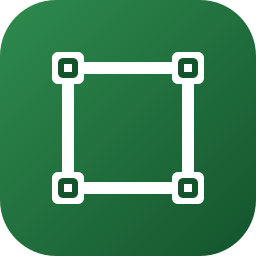
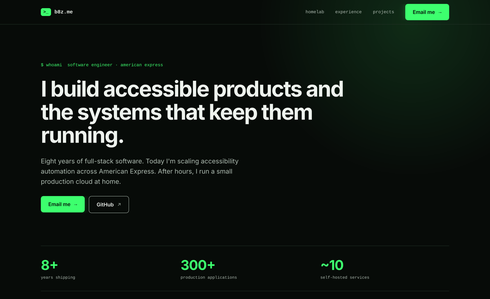
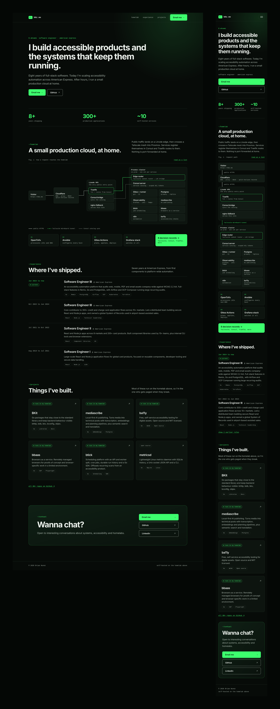
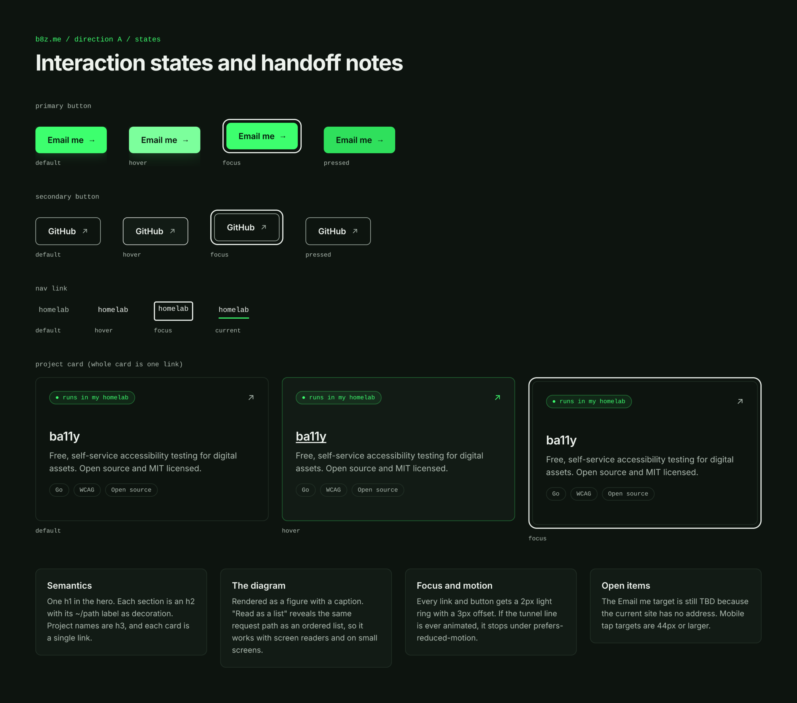

<p align="center">
  
</p>

<h1 align="center">bdesign</h1>

<p align="center">
  <b>Design files; Brian Nunez's FigCraft designs, with SVG and PNG exports.</b>
</p>

<p align="center">
  Editable FigCraft sources, each with per-frame SVGs and a PNG preview, so you can look without installing anything.<br>
  <i>By Brian Nunez.</i>
</p>

<p align="center">
  
  
  
  <br>
  <a href="https://www.linkedin.com/in/brianjnunez/"></a>
</p>

<p align="center">
  <a href="b8z-me/"></a>
</p>

<p align="center">
  <a href="b8z-me/"><b>b8z.me redesign</b></a> ·
  <a href="https://www.b8z.me/">Current b8z.me</a> ·
  <a href="https://github.com/storytold/figcraft">FigCraft</a> ·
  <a href="https://www.linkedin.com/in/brianjnunez/">LinkedIn</a>
</p>

<br>

<p align="center">
  
  <br><sub><b>b8z.me redesign</b>: the desktop hero, exported from the FigCraft file at 2x.</sub>
</p>

> [!NOTE]
> **Design files only.** Nothing here is production code. Each design is a reviewable artifact; implementations live in their own repositories.

<p align="center">
  <a href="#designs">Designs</a> ·
  <a href="#b8zme-redesign">b8z.me redesign</a> ·
  <a href="#color-reference">Color reference</a> ·
  <a href="#opening-the-files">Opening the files</a> ·
  <a href="#documentation">Documentation</a> ·
  <a href="#license">License</a>
</p>

## Designs

Each design lives in its own folder with the editable source, an SVG per frame and a preview image.

| Design | Preview | Files (.figcraft, SVG, PNG) |
| ------ | ------- | ----- |
| **b8z.me redesign**<br>Personal site for a software engineer: a homelab architecture diagram, experience and projects, on desktop and mobile. | <a href="b8z-me/preview.png"></a> | [Source](b8z-me/b8z-redesign.figcraft)<br>[Desktop](b8z-me/svg/desktop-home.svg)<br>[Mobile](b8z-me/svg/mobile-home.svg)<br>[States](b8z-me/svg/states-and-annotations.svg)<br>[Preview](b8z-me/preview.png) |

## b8z.me redesign

A redesign of [b8z.me](https://www.b8z.me/) that keeps its green-on-black terminal identity and adds real proof: the homelab that hosts the site, drawn as an architecture diagram.

- **Three frames.** Desktop (1440 wide), mobile (390 wide), and a sheet of interaction states with handoff notes.
- **Homelab, shape only.** The diagram shows the request path from Cloudflare through a Linode edge and a Tailscale mesh into Proxmox, with no IP addresses, internal hostnames or ports.
- **Readable by default.** Grey text measures at least 8.6:1 against every surface it sits on, above WCAG AAA.
- **States drawn, not implied.** Default, hover, focus and pressed for buttons, nav links and project cards, with a visible 2px focus ring.

<p align="center">
  <a href="docs/images/states.png"></a>
  <br><sub><b>States and annotations</b>: every interactive element in each state, plus notes on semantics, the diagram's text alternative, focus and open items.</sub>
</p>

## Color reference

The b8z.me palette. Every text colour is measured against every surface it sits on.

| Role | Hex |
| ---- | --- |
| Background |  `#070B08` |
| Surface |  `#0D140F` |
| Surface, raised |  `#121B15` |
| Line |  `#223026` |
| Text |  `#EEF3EE` |
| Muted text |  `#AFBCB2` |
| **Signal green** |  `#3DFF6E` |
| Ink on green |  `#04130A` |

## Opening the files

Open a `.figcraft` file in the [FigCraft](https://github.com/storytold/figcraft) desktop app to edit it. The designs use Inter and Liberation Mono, which ship with FigCraft, so they look the same on any machine.

To export without opening the app, use `figcraft-cli`:

```sh
figcraft-cli export b8z-me/b8z-redesign.figcraft -o out/ --format svg    # one SVG per frame
figcraft-cli export b8z-me/b8z-redesign.figcraft -o out/ --scale 2       # one PNG per frame, at 2x
figcraft-cli render b8z-me/b8z-redesign.figcraft -o page.png             # the whole page in one image
```

The SVGs store text as outlines, so they render without the fonts installed. They display correctly in browsers and on GitHub; some librsvg-based viewers, such as GNOME's image viewer, cannot draw the glow filter on the green buttons and refuse to open them.

## Documentation

- [Decision records](docs/adr/README.md): why designs are FigCraft files, and future decisions.
- [Agent guide](AGENTS.md): layout, export commands and commit rules for anyone, human or agent, adding a design.

## License

bdesign is licensed under the [MIT License](LICENSE). Copyright (c) 2026 Brian Nunez.
